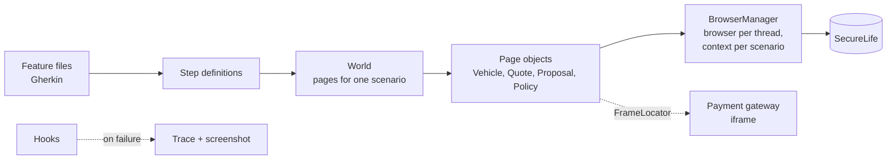

<div align="center">

# 🛡️ Playwright (Java) + Cucumber BDD Framework

**Behaviour-driven UI tests for SecureLife car insurance, including an iframe payment gateway**

    

[](https://github.com/skamirullah/practiceqa-playwright-cucumber-bdd/actions/workflows/ci.yml)  

[What it tests](#-what-it-tests) · [Quick start](#-quick-start) · [How it is built](#-how-it-is-built) · [Structure](#-project-structure) · [Reports](#-reports-and-debugging)

</div>

---

## 👋 Overview

A UI automation framework that describes an insurance purchase in Gherkin and drives it with Playwright for Java. It covers the vehicle form, plan comparison, the proposal, and payment inside an embedded gateway.

|  |  |
|---|---|
| **App under test** | [SecureLife](https://www.practiceqaautomation.com/apps/insurance), a car insurance app with quotes, plans, add-ons and policy issue |
| **Kind of testing** | UI, behaviour-driven (BDD) |
| **Tests** | 14 scenarios |
| **Runs in** | Chromium, Firefox or WebKit |

### Highlights

- **Features read like requirements.** Scenarios describe the customer's goal, not clicks.
- **Iframe handled cleanly.** The payment gateway is reached through a `FrameLocator` in one page object.
- **Parallel scenarios.** Each scenario gets its own isolated browser context.
- **Trace on failure.** A failed scenario saves a Playwright trace and a screenshot.

## 🎯 What it tests

| Area | What is checked |
|---|---|
| Vehicle details | A complete form gets plans; every missing field is named |
| Registration number | Too short, digits only, and missing state letters are refused |
| Plans | A plan is required; third-party has no own-damage cover; better cover costs more |
| Add-ons | Roadside assistance adds ₹199 and the total premium is exact |
| Buying a policy | Proposal, card payment in the gateway, policy number and card on the policy |
| Cancelled payment | Closing the gateway keeps the proposal open |
| Proposal rules | The owner must be an adult; the declaration must be accepted |

## 🚀 Quick start

**You need:** Java 17+ and Maven 3.9+. Playwright downloads its browser on the first run.

```bash
git clone https://github.com/skamirullah/practiceqa-playwright-cucumber-bdd.git
cd practiceqa-playwright-cucumber-bdd
mvn test
```

| Command | What it does |
|---|---|
| `mvn test` | Run every scenario, three at a time |
| `mvn test -Dcucumber.filter.tags="@smoke"` | Run only the smoke scenarios |
| `mvn test -Dbrowser=firefox` | Run in Firefox (or `webkit`) |
| `mvn test -Dheadless=false -Dslow.mo=300` | Watch the browser, slowed down |
| `mvn allure:serve` | Open the Allure report |

## 🧱 How it is built



- **World object with PicoContainer.** One `World` per scenario holds the page objects and anything steps need to share, such as the quoted premium.
- **Thread-safe Playwright.** `BrowserManager` keeps Playwright objects in ThreadLocals; scenarios run in parallel through the TestNG data provider.
- **Steps assert on locators.** Web-first assertions wait for the expected state.
- **Data tables.** One step checks six field errors from a table.
- **Records for data.** `Vehicle.swift()`, `Proposer.valid().bornOn(...)` and `Card.valid()`.

## 📁 Project structure

```text
src
├── main/java/com/practiceqa/securelife
│   ├── browser/BrowserManager.java # Playwright lifecycle, thread-safe
│   ├── config/Config.java          # settings from -D flags, env vars, then config.properties
│   ├── pages/                      # BasePage, VehiclePage, QuotePage, ProposalPage, PolicyPage
│   └── data/                       # Vehicle, Proposer, Card
└── test
    ├── java/com/practiceqa/securelife
    │   ├── steps/                  # VehicleSteps, QuoteSteps, PurchaseSteps, Hooks
    │   ├── context/World.java      # shared state for one scenario
    │   └── runner/                 # RunCucumberTest, CloseBrowsers
    └── resources
        ├── features/               # vehicle_details, plans, buy_policy
        └── config.properties
```

## ⚙️ Configuration

Defaults live in `src/test/resources/config.properties`. Override any of them on the command line (`-Dbrowser=firefox`) or with an environment variable (`BROWSER=firefox`); nothing needs editing to change environment.

| Setting | Default | What it does |
|---|---|---|
| `base.url` | the live site | Site to test. Point it at a local or staging build. |
| `browser` | `chromium` | `chromium`, `firefox` or `webkit`. |
| `headless` | `true` | Set to `false` to watch the browser. |
| `slow.mo` | `0` | Milliseconds to pause between actions in a headed run. |
| `timeout` | `10000` | Milliseconds an action or assertion waits before failing. |
| `threads` | `3` | Scenarios run at the same time. |

## 📊 Reports and debugging

- **Cucumber HTML**: `target/cucumber-report.html` after every run.
- **Allure**: run `mvn allure:serve` after a test run for a report with steps, timings and attachments.
- **Traces**: a failed scenario writes `target/traces/<scenario>.zip`. Open it at [trace.playwright.dev](https://trace.playwright.dev).

## 🔁 Continuous integration

[GitHub Actions](.github/workflows/ci.yml) installs the browser, runs the scenarios on every push and pull request, and uploads reports and traces.

## 🧪 About the app under test

SecureLife quotes car insurance from the vehicle's details, offers three plans with optional add-ons, collects a proposal with a nominee, and takes payment in a gateway embedded as an iframe.

[PracticeQAAutomation](https://www.practiceqaautomation.com) is a free practice site for QA engineers, with realistic apps to automate with Selenium, Playwright and Cypress. All data in these tests is fictional.

## 👤 Author

**Sk Amir Ullah** · Technical Lead, SDET and Test Automation

[Portfolio](https://skamirullah.com) · [LinkedIn](https://linkedin.com/in/skamirullah) · [GitHub](https://github.com/skamirullah) · [PracticeQAAutomation](https://www.practiceqaautomation.com)

## 📄 License

[MIT](LICENSE)
